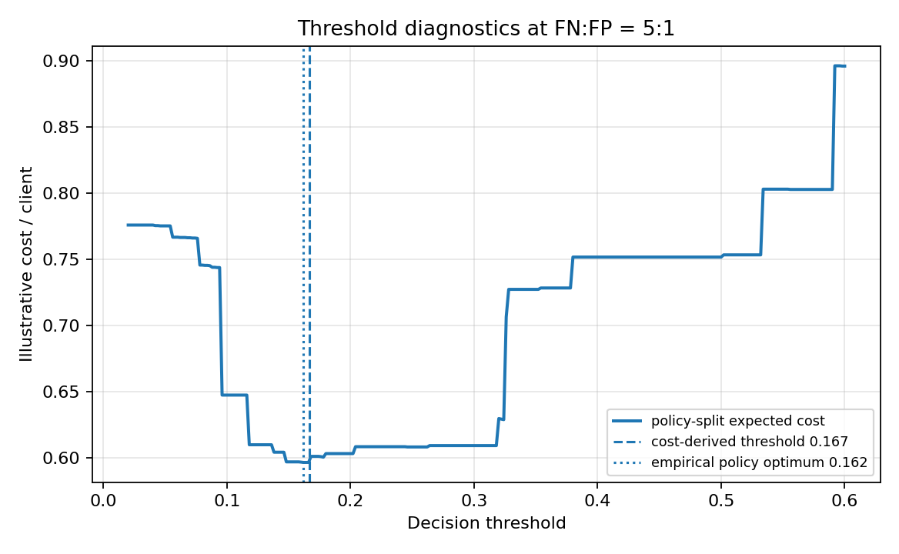
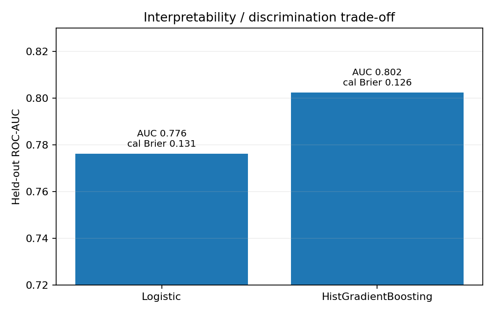
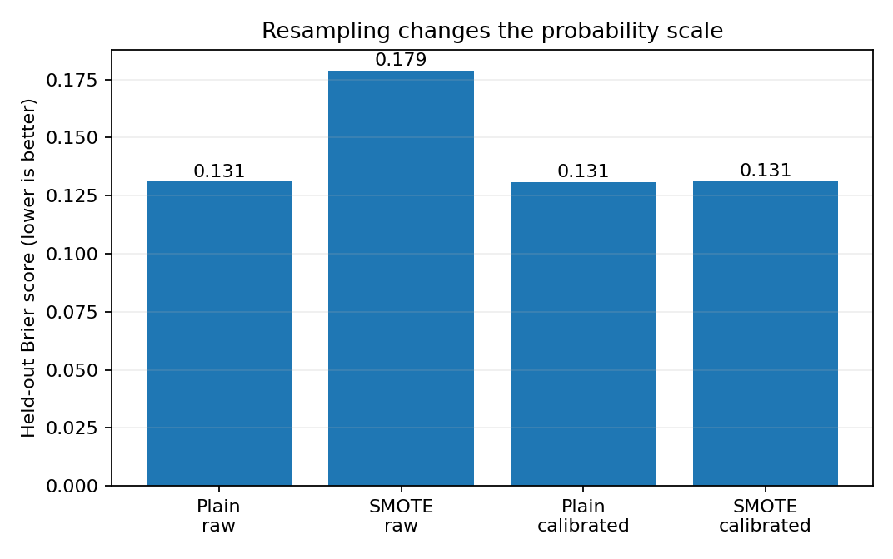
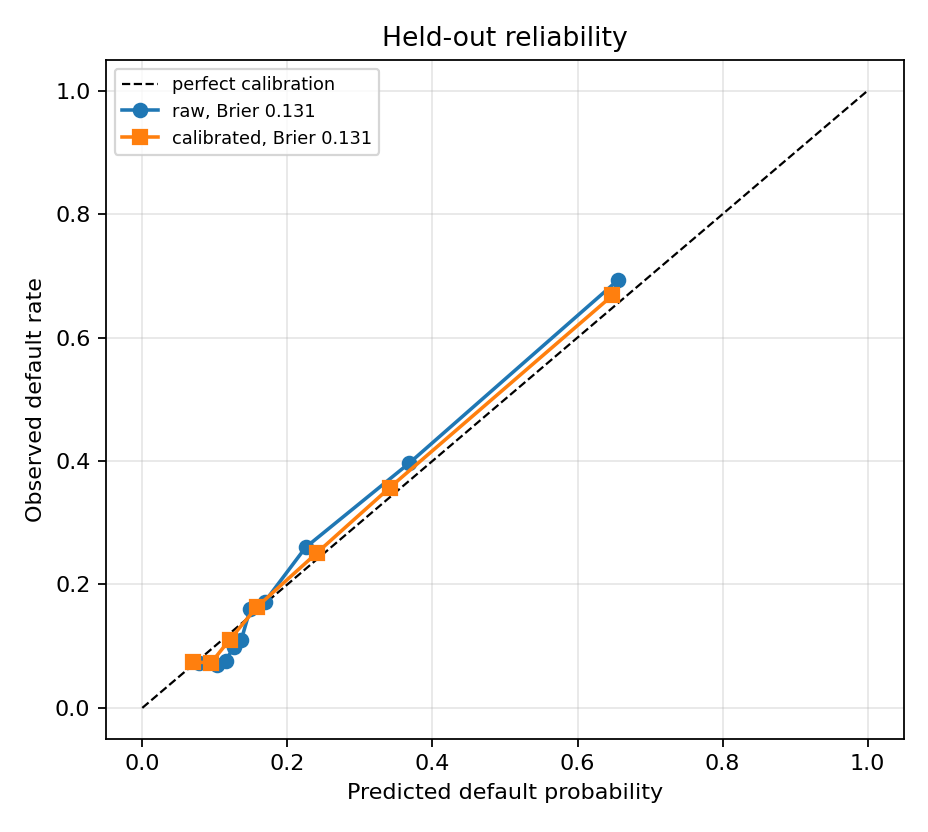
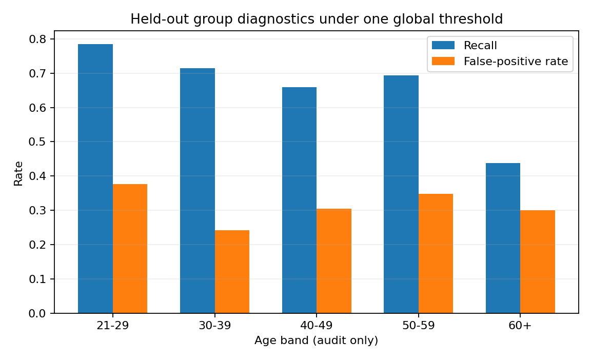
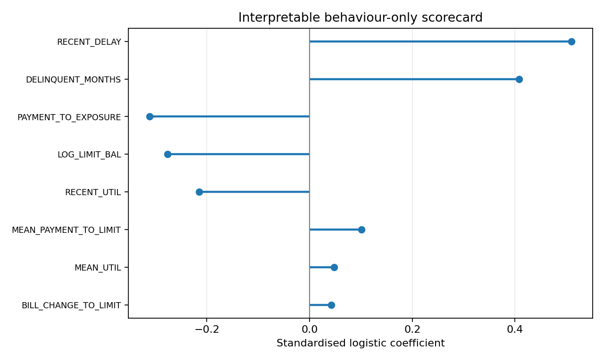

# Credit Default Decision Modelling

[](https://github.com/AhmadEblagh205/credit-default-prediction/actions/workflows/ci.yml)


A reproducible credit-default modelling benchmark built from the public UCI Taiwan credit-card dataset (30,000 clients). The project began as a five-person UCL BENG0095 group project; my original contribution focused on exploratory analysis, feature engineering and the modelling pipeline. The preserved group notebook/report remain in `notebooks/`. The modular `src/` implementation is my later individual rebuild and audit.

The v2 question is deliberately broader than **"which classifier has the highest accuracy?"**:

> **How should a lender separate ranking, probability quality, decision costs, interpretability and model governance?**

The answer turned out to require retiring several attractive but weak choices from the coursework pipeline: arbitrary outlier deletion, SMOTE in the deployed probability model, same-split calibration reporting, and a model-comparison setup that was not apples-to-apples.

## Headline findings

The final interpretable model is a regularised **behaviour-only logistic regression**. Direct demographic variables are excluded from the deployed feature matrix and retained only for a separate governance audit.

On the untouched **6,000-client held-out test file**:

| Result | Held-out value |
|---|---:|
| Logistic ROC-AUC | **0.776** |
| Logistic average precision | **0.540** raw ranking |
| Logistic Brier score | **0.131** calibrated |
| Recall at the illustrative 5:1 FN:FP cost rule | **0.714** |
| Precision at that rule | **0.385** |
| Flag rate | **0.392** |
| Expected illustrative cost / client | **0.543** |

The calibrated 5:1 decision threshold is not guessed from a curve. For false-negative cost `5` and false-positive cost `1`, the transparent probability rule is

```text
threshold = C_FP / (C_FN + C_FP) = 1 / 6 = 0.167
```

The separate policy split gives an empirical optimum of **0.162** with the **same measured policy cost** at the theoretical `1/6` threshold. A bootstrap of the point optimum is broad (**~0.147–0.320**), which is a useful warning against treating one sample-specific optimum as a universal operating rule.



### 1. The performance / interpretability trade-off is real — and now measured fairly

Logistic regression and histogram gradient boosting are tuned on the **same fit split**, calibrated on the **same calibration split** and scored on the **same untouched test clients**.

- logistic ROC-AUC: **0.776**
- histogram gradient boosting ROC-AUC: **0.802**
- held-out gap: **2.61 AUC points**
- paired bootstrap 95% interval for the gap: **1.72 to 3.50 AUC points**

So the interpretable scorecard does give up discrimination here. The reason for keeping it as the primary model is not that it secretly performs just as well; it is that its feature contributions are exact on the raw log-odds scale and the cost of that transparency is explicitly quantified.



### 2. SMOTE was useful coursework — but it is a poor default for calibrated probabilities here

The original project used SMOTE because only about one client in five defaults. Re-running that idea under a clean split protocol exposed the cost:

| Logistic variant | Held-out raw Brier | Held-out ROC-AUC |
|---|---:|---:|
| Plain logistic | **0.131** | **0.776** |
| SMOTE logistic | **0.179** | **0.773** |

After disjoint isotonic calibration both Brier scores return to roughly **0.131**. In other words, SMOTE badly changes the raw probability scale without improving ranking in this benchmark. The final decision pipeline therefore keeps the natural class prior and lets **calibrated probabilities + an explicit cost rule** handle asymmetric decisions.



### 3. Calibration is checked on data not used to fit the calibrator

The dramatic old headline (`0.197 -> 0.137`) was measured on the same validation data used to fit isotonic calibration. It is retired.

With the v2 split protocol, the held-out test Brier score changes only slightly:

```text
raw logistic       0.13114
isotonic calibrated 0.13101
```

That is itself informative: once SMOTE is removed, the plain logistic model is already reasonably calibrated. Calibration is retained because the project explicitly tests probability quality, not because every calibration step must produce a large win.



### 4. Demographic variables are not required for most of the ranking signal

The deployed model excludes `SEX`, `MARRIAGE`, `AGE` and `EDUCATION`. A separate development audit adds them back only to quantify the trade-off:

```text
policy AUC, behaviour only       0.7464
policy AUC, + demographics       0.7496
gain                              0.0032
```

The untouched test confirmation is similarly small (`+0.0042` AUC).

This **does not prove fairness or legal compliance**. The project therefore also reports held-out recall, false-positive rate, flag rate and Brier score across source-reported sex categories and age bands under the **same global threshold**. The smallest age band contains only 56 clients, so those diagnostics are explicitly treated as uncertain rather than as grounds for group-specific policy.



## Data and split protocol

`download_data.py` fetches the public UCI dataset and recreates the original coursework split:

- first 24,000 rows: development data
- final 6,000 rows: untouched test data

The 24,000 development rows are then stratified into:

- **14,400 fit rows** — model fitting and cross-validation only
- **4,800 calibration rows** — isotonic calibration only
- **4,800 policy rows** — threshold diagnostics only

The 6,000 test rows are not used for model selection, calibration fitting or threshold selection.

Raw data is git-ignored. The public repository contains the download/rebuild script rather than redistributing the dataset as a project asset.

## Feature design

The v2 model uses a compact, dimensionally interpretable behaviour set:

- log credit limit;
- recent and mean bill utilisation;
- bill change relative to credit limit;
- mean payment relative to credit limit;
- payments relative to total exposure;
- most recent positive delinquency delay;
- number of delinquent months.

This replaces the original recursive `AV_EXP*` chain, which mixed already-normalised quantities with raw currency amounts and was difficult to defend dimensionally. It also avoids arbitrary deletion of financially unusual clients.

Direct demographic attributes are not model inputs.

## Exact reason codes — with the correct scope

For the fitted standardised logistic model,

```text
raw logit = intercept + sum_j beta_j * z_j
```

so `beta_j * z_j` is an **exact additive contribution to the raw log-odds**. `src/explain.py` reports both risk-raising and protective contributions for a held-out client.

The isotonic calibrator is monotone but non-additive. Therefore the reason codes are **not** claimed to sum to the calibrated probability, and they are not causal explanations.



## Reproduce

```bash
pip install -r requirements.txt
python src/download_data.py
python src/train.py
python src/model_comparison.py
python src/resampling_audit.py
python src/governance_audit.py
python src/explain.py --row 12
pytest -q
```

Current test suite: **14 tests**.

## Repository map

```text
src/
  features.py             behaviour-only feature contract
  modeling.py             splits, fitting, calibration and metrics
  decision.py             analytic/empirical threshold diagnostics
  train.py                final logistic decision pipeline
  model_comparison.py     fair logistic vs gradient-boosting comparison
  resampling_audit.py     plain vs SMOTE probability audit
  governance_audit.py     demographic-exclusion + subgroup diagnostics
  explain.py              exact raw-logit reason codes
  download_data.py        UCI acquisition + coursework split

docs/
  METHODOLOGY.md
  MODEL_CARD.md
notebooks/
  group_project_original.ipynb
  group_project_report.pdf
reports/
  metrics.json and reproducible audit summaries/figures
```

## What this project does **not** claim

- It is not a lending product or a production credit decision system.
- The illustrative 5:1 cost ratio is not an estimate of real lender economics.
- The UCI sample is historical and not evidence of present-day population performance.
- Subgroup diagnostics do not establish fairness, bias, causality or regulatory compliance.
- Exact logistic reason codes explain the fitted model, not the true causal reason for default.
- The stronger gradient-boosting model is not hidden: the performance/interpretability trade-off is part of the result.

## Licence

MIT for this repository's code. Dataset: UCI Machine Learning Repository, **Default of Credit Card Clients**; refer to the source dataset page for its current data terms.
